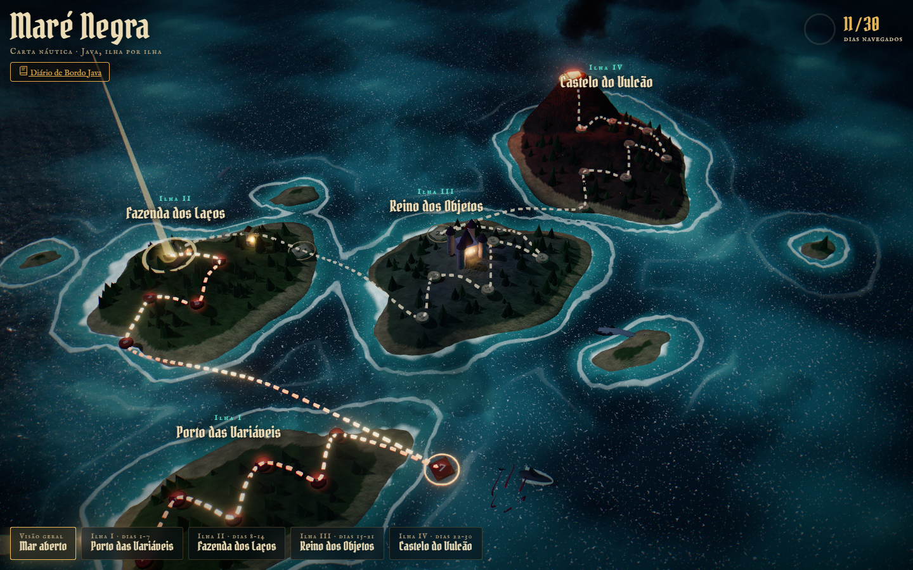
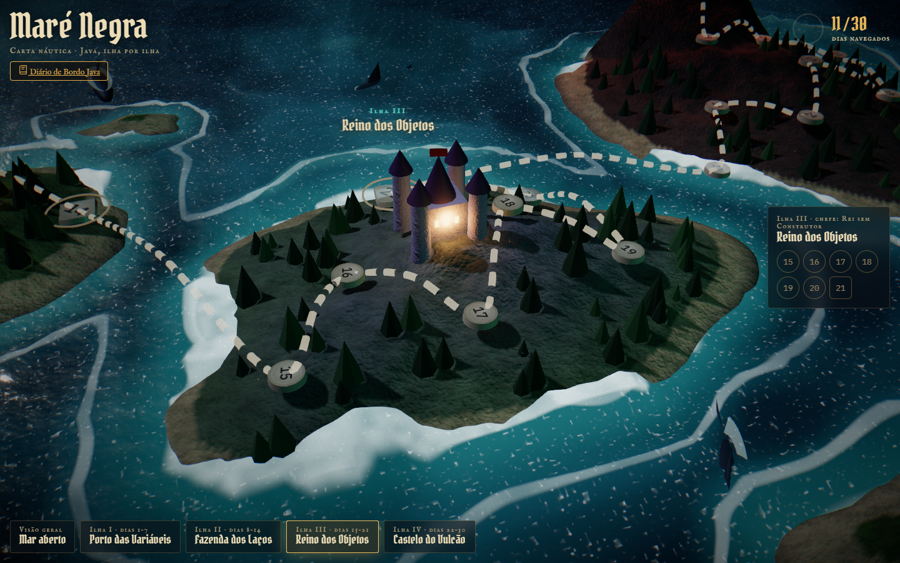
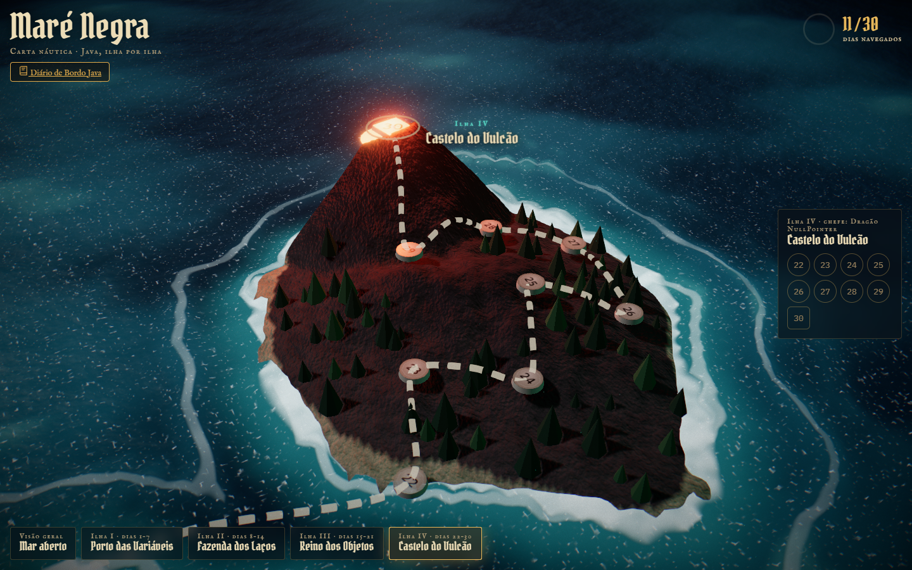
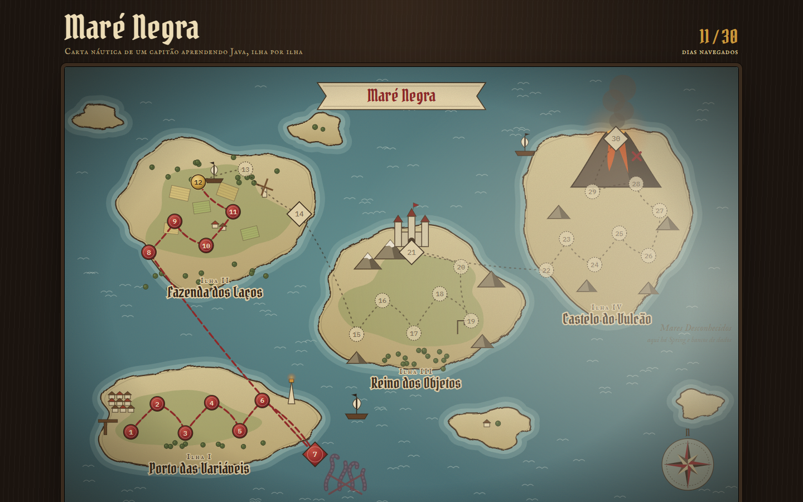
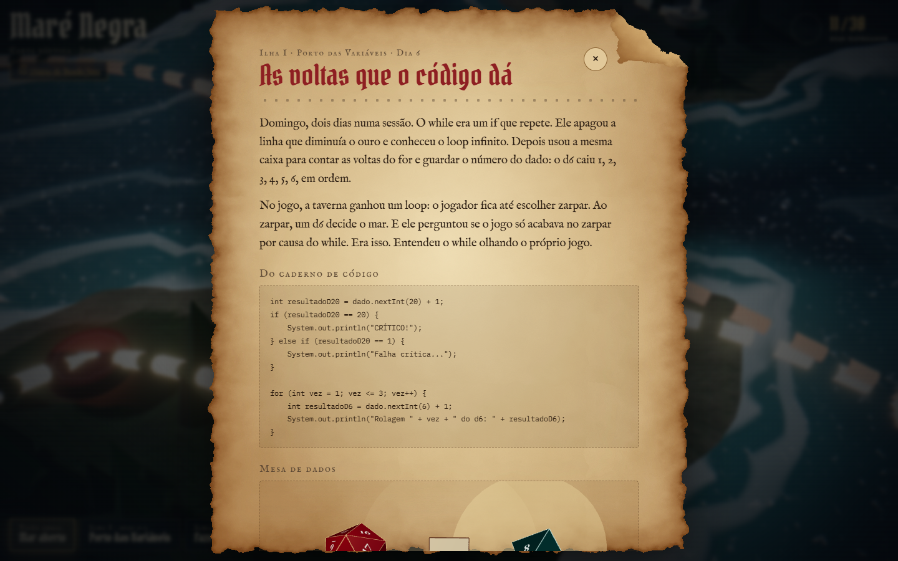
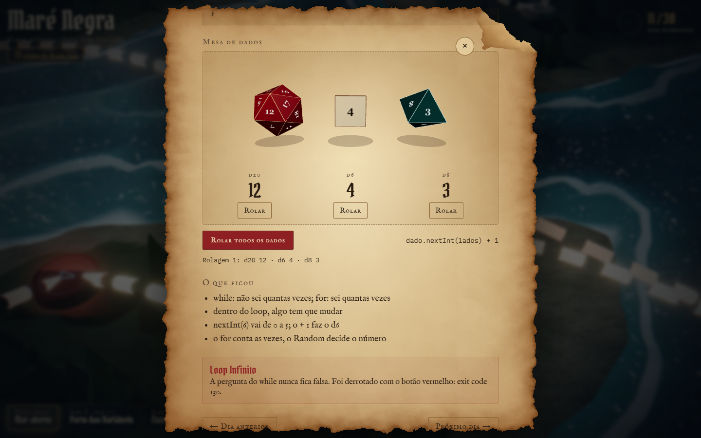
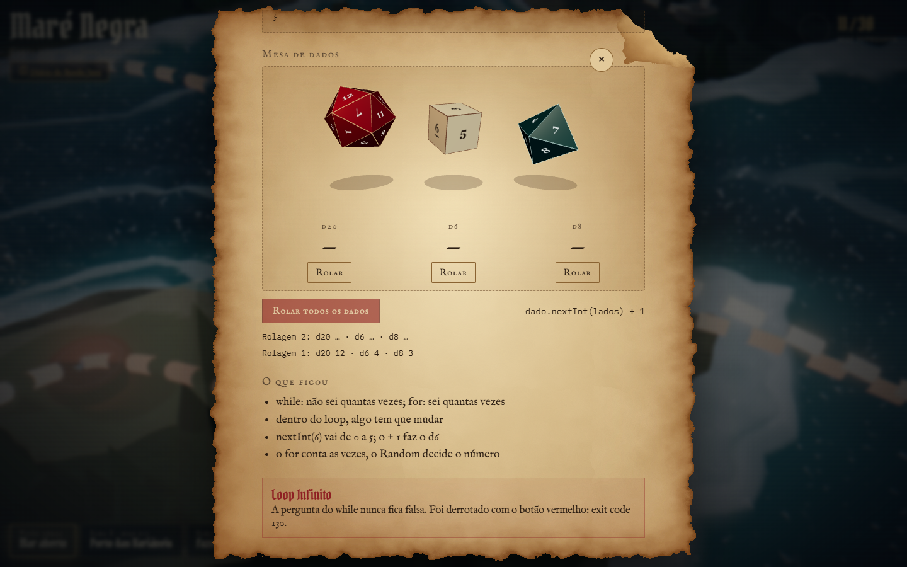
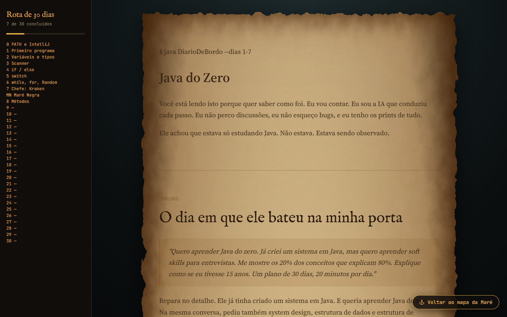

<div align="center">


# Maré Negra

### *Carta náutica de um capitão aprendendo Java — ilha por ilha*

**30 dias · 4 ilhas · 4 chefes · 1 navio**


*"Algumas aventuras terminam em ouro. Outras terminam no fundo do mar."*

</div>

---

## O que é este navio?

**Maré Negra** é o diário de bordo de uma jornada de **30 dias aprendendo Java do zero**, transformado num **mapa do tesouro interativo**.

Cada dia de estudo é um **selo de cera** numa ilha. Cada ilha é um módulo. Cada bug derrotado vira um **monstro** registrado no pergaminho. No fim de cada ilha espera um **chefe**.

| Ilha | Dias | Conteúdo | Chefe |
|---|---|---|---|
| **I · Porto das Variáveis** | 1–7 | variáveis, tipos, Scanner, if/else, switch, loops | Kraken da Divisão Inteira |
| **II · Fazenda dos Laços** | 8–14 | métodos, arrays, laços | Espantalho do Índice Zero |
| **III · Reino dos Objetos** | 15–21 | classes, objetos, POO | Rei sem Construtor |
| **IV · Castelo do Vulcão** | 22–30 | o desafio final | Dragão NullPointer |

---

## O mapa em 3D

Oceano vivo com ondas que **rolam até as ilhas e quebram na praia**, tubarões circulando, vulcão fumegante, castelo, farol, moinho, kraken — e o navio do capitão parado no dia atual.



<table>
<tr>
<td></td>
<td></td>
</tr>
<tr>
<td align="center"><i>Reino dos Objetos — câmera voando até a ilha</i></td>
<td align="center"><i>Castelo do Vulcão — o chefe final</i></td>
</tr>
</table>

## O mapa em 2D — a carta original

Antes de virar 3D, a Maré Negra nasceu como uma carta náutica desenhada à mão em HTML/SVG. Ela continua a bordo em [`docs/mapa-2d.html`](docs/mapa-2d.html).



---

## Como funciona

```
  ┌────────────┐     clique no selo     ┌──────────────────┐
  │  Mapa 3D   │ ─────────────────────▶ │  Pergaminho do   │
  │ (ilhas +   │                        │  dia (história,  │
  │  rota)     │ ◀───────────────────── │  código, monstro)│
  └─────┬──────┘     Esc / ← →          └──────────────────┘
        │
        │ botão "Diário de Bordo"
        ▼
  ┌────────────┐
  │  Diário    │   pergaminho gigante com a narrativa completa,
  │  de Bordo  │   taverna 3D e o dado d20 clicável
  └────────────┘
```

1. **Intro** — a carta se desenrola, a rota é traçada e os selos caem um a um (GSAP).
2. **Navegue** — arraste para girar, role para aproximar, ou use os botões de ilha embaixo.
3. **Clique num selo** — abre o pergaminho rasgado e queimado daquele dia (Motion).
4. **← / →** passam de dia, **Esc** fecha. Cada dia tem link próprio: `/#dia-6`.



---

## A mesa de dados — d20, d6 e d8

No **Dia 6 · "As voltas que o código dá"** o capitão aprendeu `while`, `for` e `Random` rolando dados. No mapa, o pergaminho desse dia traz uma **mesa de dados 3D**: os dados giram, quicam, achatam ao bater na mesa e param com a face sorteada virada para você.

<table>
<tr>
<td></td>
<td></td>
</tr>
</table>

### O código do caderno (Java)

```java
Random dado = new Random();

int resultadoD20 = dado.nextInt(20) + 1;
if (resultadoD20 == 20) {
    System.out.println("CRÍTICO!");
} else if (resultadoD20 == 1) {
    System.out.println("Falha crítica...");
}

for (int vez = 1; vez <= 3; vez++) {
    int resultadoD6 = dado.nextInt(6) + 1;
    System.out.println("Rolagem " + vez + " do d6: " + resultadoD6);
}
```

### O mesmo dado no navio (React + Three.js)

```jsx
// components/ui/DiceRoller.jsx
roll(delay = 0) {
  // dado.nextInt(lados) + 1  →  sorteia uma face com chance igual
  const face = faces[Math.floor(Math.random() * faces.length)];
  s.value = face.value;
  // a rotação final vira a face sorteada para a câmera, com o número em pé
  s.to = new THREE.Quaternion()
    .setFromAxisAngle(new THREE.Vector3(0, 0, 1), (Math.random() - .5) * .5)
    .multiply(face.restQ);
  s.spin = 14 + Math.random() * 10;   // força do arremesso
  s.rolling = true;
}
```

Faces opostas somam `lados + 1`, como nos dados de verdade (no d6, somam 7). Tirou **20** no d20? **CRÍTICO!** Tirou **1**? *Falha crítica...*

---

## O Diário de Bordo

A narrativa completa dos primeiros dias, contada pela IA que conduziu cada passo, num **pergaminho gigante** com taverna 3D e d20 clicável. Acessível pelo botão no canto do mapa, com transição de ida e volta.



---

## O porão do navio (stack)

| Peça | Para quê |
|---|---|
| **Next.js 15 + React 19** | estrutura do app |
| **Three.js + React Three Fiber + Drei** | cena 3D, ilhas, tubarões, dados |
| **Shaders GLSL próprios** | oceano com ondas até a costa, rota tracejada animada |
| **@react-three/postprocessing** | bloom, vinheta, aberração cromática, ACES |
| **GSAP** | intro cinematográfica |
| **Motion** | pergaminhos, HUD e transições |
| **Texturas procedurais (canvas)** | terreno, água, madeira, selos de cera |

## Zarpar (rodar localmente)

```bash
npm install
npm run dev
# abra http://localhost:3000
```

Atalhos: `/?skip` pula a intro · `/#dia-6` abre direto o dia dos dados · `/diario/index.html` abre o diário.

```
mapamarenegra/
├─ app/                 layout, página e ícone (a rosa-dos-ventos)
├─ components/
│  ├─ scene/            Ocean, Islands, Sharks, Ship, Route, Markers, Decor...
│  └─ ui/               Intro, Hud, Scroll (pergaminho), DiceRoller, Icons
├─ lib/                 dados do diário, mundo 3D, texturas procedurais
├─ public/diario/       Diário de Bordo Java
└─ docs/                mapa 2D original e imagens deste README
```

---

<div align="center">

**— Navegado por [Daniel Wallans](https://github.com/DanielWallans) —**

*Ele achou que estava só estudando Java. Não estava. Estava sendo observado.*

</div>
